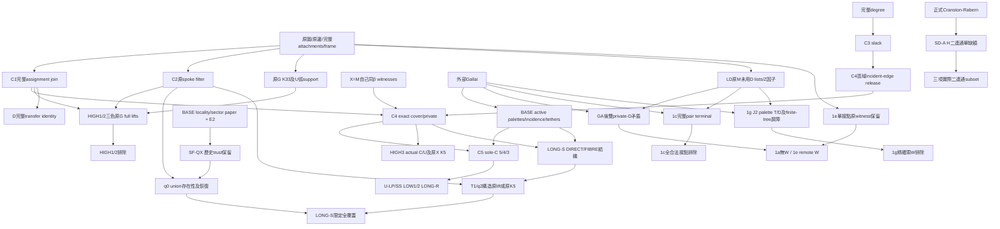

# MATH-CONSOLIDATE-1：Proof dependency DAG

固定HEAD：`8c56b76922a1c7ac4c011096f2041b49c4a67cc8`。圖中箭頭一律 **依賴→使用者**。
本圖是具名proof-family投影：原33個canonical bundles與LONG61 labels的細粒度接口／完整量詞見 [inventory](THEOREM_INVENTORY.md)。收縮family不等於消去其內部的數學義務。

所有端點另受inventory的完整來源合同（C_S/C_U、各HIGH合同、K_LONG、BRC+SK+分支）限制；圖不把合同clauses畫成新定理。必須同原圖、同β、同literal frame及完整資料後才可沿edge套lemma。BR形狀是該分支的**假設**，沒有SD-A⇒BR形狀的隱含edge。

## 主要結構圖（閱讀視圖）

此閱讀圖省略各branch專有前提，不用作數值分母。D沒有指向LONG-S存在性；finite calibration／seal沒有指向任意大小排除；CR／SD-A沒有指向BR。

## 可重算的family edge ledger

以下列出完整計數圖的每個target與所有immediate inputs；每一逗號展開為一條edge。前提型leaf的意義亦列出。一般ignored-point因子、原spoke／hub及tuple full-preimage條件藏於ACTUAL／branch合同，**沒有刪除**。

| Target | 意義 | Immediate inputs |
| --- | --- | --- |
| `ACTUAL` | 原vertices/edges/attachments及literal frame | 原合同／直接已知依賴；無此投影內parents |
| `OWN` | X=M自己同β minimal與刪邊witnesses | 原合同／直接已知依賴；無此投影內parents |
| `DEGREE` | 完整原degree與外鄰 | 原合同／直接已知依賴；無此投影內parents |
| `SHIELD` | B-S0原witness盾弧及star預算 | 原合同／直接已知依賴；無此投影內parents |
| `DIAG` | E4 N-diagonal完整piece lifts | 原合同／直接已知依賴；無此投影內parents |
| `GA` | 外部Gallai blockwise palettes | 原合同／直接已知依賴；無此投影內parents |
| `INC` | C6同一block incidence columns | `ACTUAL` |
| `E2` | BASE E2任意大小paper | 原合同／直接已知依賴；無此投影內parents |
| `UNATTACHED` | 原unattached boundary T4改色lemma | 原合同／直接已知依賴；無此投影內parents |
| `CR` | Cranston-Rabern正式單缺額分類 | 原合同／直接已知依賴；無此投影內parents |
| `JOIN` | C1完整assignment join | `ACTUAL` |
| `FILTER` | C2原spoke literal filter | `ACTUAL` |
| `SLACK` | C3 connected list slack | `DEGREE` |
| `RELEASE` | C4 incident-edge全pin解除 | `ACTUAL`, `SLACK` |
| `COVER` | C4 own-β exact cover/private | `JOIN`, `OWN`, `RELEASE` |
| `SOLE` | C5 sole-C的5/4/3分流 | `COVER`, `TRI3`, `TRI4`, `PAR5` |
| `TRI3` | BASE三contact active triangle/原tethers/K5 | `GA`, `INC`, `SLACK`, `DEGREE` |
| `TRI4` | BASE四contact共同三palettes/兩triangle | `GA`, `INC`, `SLACK`, `DEGREE` |
| `PAR5` | BASE五contact四palettes偶葉矛盾 | `GA`, `INC`, `DEGREE` |
| `MINOR_G` | 具名原G K33/bags/原spokes | `ACTUAL` |
| `ARC` | HIGH原U連續三點support | `MINOR_G`, `SHIELD` |
| `COLOR` | C7 actual-support完整色雙射 | `ACTUAL` |
| `H1_GLIFT` | HIGH1三色r=s=D原G lift/Q⊆T | `ARC`, `COLOR`, `DIAG`, `JOIN`, `FILTER` |
| `H2_W` | HIGH2原bridge及两W rooted assignments | `COVER`, `GA`, `INC`, `SHIELD`, `MINOR_G` |
| `H2_GLIFT` | HIGH2三色原G lift/Q⊆B−T | `H2_W`, `ARC`, `COLOR`, `DIAG`, `JOIN`, `FILTER` |
| `H3_HUB` | HIGH3 retained避U原外路 | `ACTUAL` |
| `LP_MID` | LP原未接中點/actual sole-C | `SHIELD`, `UNATTACHED` |
| `SS_MID` | SS有序盾費/一點或兩點改色 | `SHIELD`, `UNATTACHED` |
| `DIRECT` | LONG-S四direct profiles原外hub | `COVER`, `TRI3`, `TRI4` |
| `SF_SPLIT` | LONG-S FIBRE singleton/pair13/31排除 | `COVER`, `GA`, `SHIELD`, `LOWINC` |
| `SF_ROLE` | split22原C上界及β角色 | `SF_SPLIT`, `BASE_LOCAL` |
| `BASE_LOCAL` | BASE residual-locality/sector/CaseII paper | 原合同／直接已知依賴；無此投影內parents |
| `QX` | SF-QX採納/歷史finite-terminal信任界 | `BASE_LOCAL`, `E2`, `OWN` |
| `T1` | T1十四schedules原K5或構造restorable lift | `SF_ROLE`, `TRI3`, `COLOR`, `DIAG`, `JOIN`, `FILTER` |
| `T2Q0` | q0三schedules非空聯集＋空r fibre | `SF_ROLE`, `QX`, `COLOR`, `DIAG`, `JOIN`, `FILTER` |
| `T2Q2` | q2七schedules直接构造q3/q4 lifts | `SF_ROLE`, `SLACK`, `COLOR`, `JOIN`, `FILTER` |
| `SF_PRIOR4` | 歷史q0→q1四schedules恢復 | `SF_ROLE`, `BASE_LOCAL`, `COLOR`, `JOIN`, `FILTER` |
| `TRANSFER` | D actual-block recurrence/preimages/empty fibres | `JOIN`, `FILTER`, `COLOR` |
| `DLIST` | LD原M unused-D lists及完整Z乘積 | `ACTUAL`, `DEGREE` |
| `DP` | DP shared-block private-D矛盾 | `GA` |
| `PW` | PW remote單接點保持雙witness | `ACTUAL` |
| `TERM` | TERM完整pair-supported末端引理 | `DLIST`, `GA` |
| `J2_WIT` | 1g原J2 w2及actual pair→palette T/D | `DLIST`, `GA`, `ACTUAL` |
| `BARRIER` | PB finite incidence-tree J2屏障 | `J2_WIT`, `GA` |
| `CAP` | 原degree容量先排非法接點 | `DEGREE`, `ACTUAL` |
| `WIT0` | 1a原無旁支雙private witnesses | `ACTUAL` |
| `C_ROUTE_ALT` | 1c原PROOF§5完整J2 routing | `DLIST`, `GA` |
| `C_DP_ALT` | 1c原PROOF§4保雙witness的部分接點 | `DLIST`, `DP` |
| `H1_MAP_ALT` | HIGH1 supporting完整MAP分類 | `COVER`, `BASE_LOCAL` |
| `U_LP` | U-LP exclusion | `LP_MID`, `SOLE` |
| `U_SS` | U-SS exclusion | `SS_MID`, `SOLE` |
| `LOW1` | LOW1 exclusion | `COVER`, `SOLE` |
| `LOW2` | LOW2 exclusion | `COVER`, `SOLE` |
| `HIGH1` | HIGH1 exclusion | `H1_GLIFT` |
| `HIGH2` | HIGH2 exclusion | `H2_GLIFT` |
| `HIGH3` | HIGH3 exclusion | `COVER`, `H3_HUB`, `TRI3` |
| `LONG_R` | LONG-R exclusion | `SHIELD`, `SOLE` |
| `LONG_S` | LONG-S exclusion | `DIRECT`, `SF_SPLIT`, `SF_PRIOR4`, `T1`, `T2Q0`, `T2Q2` |
| `BR_A` | BR-SD-1a exclusion | `DLIST`, `DP`, `WIT0` |
| `BR_C` | BR-SD-1c exclusion | `CAP`, `TERM` |
| `BR_E` | BR-SD-1e exclusion | `CAP`, `PW`, `DLIST`, `DP` |
| `BR_G` | BR-SD-1g exclusion | `CAP`, `DLIST`, `BARRIER` |
| `PRE_S_U2` | S兩原unary排除 | `SHIELD`, `ZERO`, `LOWINC` |
| `PRE_U_U2` | U兩原unary排除 | `SHIELD`, `ZERO`, `LOWINC` |
| `PRE_U_SHORT` | U兩short排除 | `PRE_U_U2`, `DIAG`, `JOIN` |
| `PRE_PG_S1` | PG整份S一頂點排除 | `MINOR_G`, `ZERO`, `ACTUAL` |
| `LOWINC` | S04 compatibility與U-S3 support兩lemma | `DIAG`, `GA`, `ACTUAL` |
| `ZERO` | B-C2 sameβ complete-column零slack | `JOIN`, `ACTUAL` |
| `SHORT_NEC` | S05/S06兩short唯一U及LOW/HIGH必要型 | `PRE_S_U2`, `SHIELD`, `LOWINC` |
| `COR_U` | 限定整U composition | `PRE_U_U2`, `PRE_U_SHORT`, `LOWINC`, `SHIELD`, `U_LP`, `U_SS` |
| `COR_LOW` | 限定LOW composition | `SHORT_NEC`, `LOW1`, `LOW2` |
| `COR_HIGH` | 限定HIGH composition | `SHORT_NEC`, `HIGH1`, `HIGH2`, `HIGH3` |
| `COR_SHORT` | 限定S兩short composition | `COR_LOW`, `COR_HIGH` |
| `SDA` | SD-A二連通單缺額 | `CR`, `DEGREE`, `ACTUAL` |
| `APP_LL` | 二連通無U兩long subset | `SDA`, `SHIELD` |
| `APP_LS1` | 二連通無U long/singleton subset | `SDA`, `LOWINC` |
| `APP_AD2` | 二連通相鄰兩mixed subset | `SDA`, `ACTUAL` |

計數：**77個family nodes，183條必要依賴edges**。使用逐edge expansion及Kahn topological sort檢查無環；這是本輪整理的依賴索引，不是機器形式化proof。

## 重複路線、可省依賴與before/after

| 主文曾並列的路線 | 最短呈現 | 必须留存的原證據 |
| --- | --- | --- |
| 1c：雙private witness部分接點／J2 routing／terminal三路 | degree先排非法接點；其餘**全部**由未改J3/q的TERM直接排除 | [1c PROOF§4–7](../../audits/2026-10-11-br-sd-1c-fd6e1112/PROOF.md):90–178與負控制照留；[final review](../../audits/2026-10-11-br-sd-1c-fd6e1112/agents/paper/REVIEW.final-v2.md):29–34已核全接點 |
| HIGH1：完整MAP分類與最後G-lift反證 | 原K33→ARC→同列U capacity/色搬運+N-diagonal→原G lift→Q集合矛盾 | HIGH1-MAP仍是已採supporting compatibility命題；[原HIGH1§5–8](../../audits/2026-10-10-n45-s-high1/REPORT.md)與[H1A](../../audits/2026-10-10-n45-h1a/REPORT.md)保留 |
| U-LP：五個PR relation helpers與排除同列展示 | 原盾中點／T4定位→actual sole C→BASE5/4/3即可 | [PA](../../audits/2026-10-10-n45-pa/REPORT.md):56–57已明說LP不依五helpers；TRANSPORT/ENDPOINT/SATURATION/ESCAPE/FORCING各自已採，不誤画closure edges |
| HIGH2：MAP必要表與直接主排除 | 可短述supporting表，但原slit-order／crosscut、pair bridge／W assignments／one-edge/K5來源前提仍必用 | 移除所有MAP背景容易誤刪完整W结构與色角色前提；本提案不無條件剪這條edge |

為量化**路線選擇**，before多顯示3條alternative presentation edges：`C_DP_ALT→BR_C`、`C_ROUTE_ALT→BR_C`、`H1_MAP_ALT→HIGH1`；after改為旁註引用，主路線alternative edges由3到0。必要數學edge ledger仍為**183→183**；含alternative的呈現edge為**186→183**。這3条原本就不是全部必須的依賴，不將其刪去宣稱解除3個來源前提。

同一lemma引用還可收縮重複local名字，但每支actual graph／pins／support核對edge仍保留。外部GA／BASE信任及SF-QX历史鏈没有減少，endpoint完整合同移除數0。

## 細粒度LONG-S及歷史信任鏈

### SF採納更正後的explicit dependencies

| Claim | Immediate mathematical dependency extracted from source proof |
| --- | --- |
| SF-JOIN | Actual unpinned-s C/L/S/U edge decomposition, literal attachments/spokes and all preimages. |
| SF-PRIVATE | SF-JOIN, connected degree4 unpinned slack, X own same-β spoke/contact deletion witnesses; incident-edge-release additionally degree-list tightness/slack. |
| SF-R-PROFILES | LONG shield/star degree identity; pair PG K3,3 ports or singleton S04; kept separate. |
| SF-SPLIT-EXCLUSION | SF-PRIVATE + SF-R-PROFILES; external Gallai + retained-spoke connected exterior K4 exclusion; actual C−r=L⊔S. |
| SF-C-BOUND | SF-SPLIT-EXCLUSION + BASE any-row double-forbidden bridge-path lemma. |
| SF-T1-MAP | SF-PRIVATE/SF-C-BOUND; complete BASE single-spoke support/relation classification; corrected30-query partition. |
| SF-T1-EXTEND | BASE arbitrary-size residual-locality/source-minor/extension theorem, T4 and own X core; no restored r-color guarantee. |
| SF-T2-MAP | SF-PRIVATE/R-PROFILES and complete sector/minimal-spoke-color/forbidden03 laws. |
| SF-T2-ROLE | SF-SPLIT-EXCLUSION/SF-T2-MAP; actual induced pentagon Y; its own δ-minimality via tightness/slack; BASE all-degree4 multi-odd-cycle three-color theorem (no T4 needed). |
| SF-T2-EXTEND | SF-T2-ROLE; whole-source transport to BASE nonadjacent CaseII. |
| SF-QX | SF-T1-EXTEND or SF-T2-EXTEND; E2 paper and own X ε1/Σ-critical/T4; both β-neighbor X extensions. |
| SF-RESTORE | Same actual G=X+e and literal original r/frame inequality only. |
| SF-T2-Q0-Q1-RESTORED | β role/U identity + same-source L transport + empty β fibre; q1 X existence has independent-review direct paper supplement (main review:45–53), not need missing final JSON for this query. |
| SF-RESIDUAL | SF-QX + SF-RESTORE + **SF-T2-Q0-Q1-RESTORED** + whole-frame schedule enumeration. |
| SF-FINITE | Fixed19 controls/21 omissions, direct original-edge all-lift comparisons; no source exclusion edge. |

In particular QX/EXTEND are legitimate inherited arbitrary-size paper dependencies under their recorded trust boundary. A missing final JSON is a custody/replay limitation rather than proof of mathematical falsehood; it cannot be relabelled a fresh verified replay.

T1、q0、q2每個原label及其完整量詞／recorded parents見inventory模組F。q2的新seed／target構造不直接使用N-diagonal；其β-role及其他上游已採前提仍保，故沒有DIAG→T2Q2直接edge。T1與q0則各自明用原S N-diagonal。QX/EXTEND沿BASE paper與historical finite-terminal，q0繼承此鏈；dependent finite replay本輪及原相關review未執行、兩缺BASE blobs保留。T1／q2的新存在性由各自紙面構造承擔，但SFβ-role／N-diagonal／GA等上游仍保。

**被禁止的圖edge：** `D-transfer→一般Δ可恢復非空`、`GΣ-critical→X同βminimal`、`βminimal→H二連通`、`一維marginals→full lift`、`finite0trigger/seal→source排除`、`1a/1c/1e/1g→完整split22 closure`。這些不是可壓縮依賴，分別是未證義務或錯誤推論。
