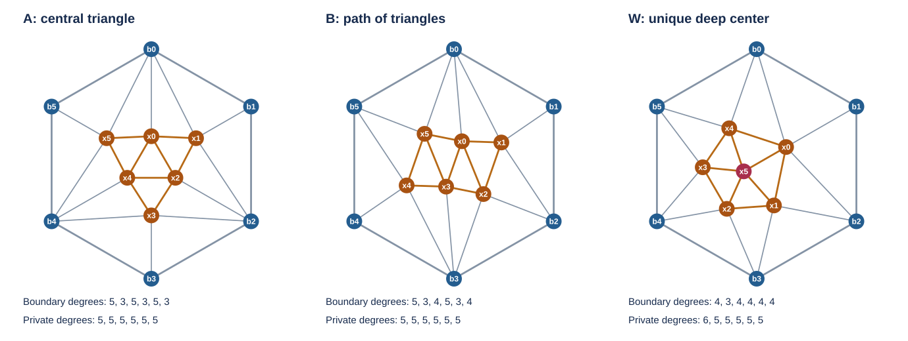

# C6 六私人點 cap 完整接線與 C8 方法域用盡

2026-10-13。Git BASE `6943561e644e7598342d1ccd7df44dac0ebcd5cf`。
接續使用者指定的 [pocket 化約](../2026-10-13-c8-pocket-reduction-6943561/REPORT.md)。
直接工作樹與前輪 frozen authority 已另行凍結，來源及 hashes 見
[INPUTS](INPUTS.json)；未把未提交的舊 audit 當成 BASE 內容。

**剩餘兩類核心的全部接線已完成：恰有三型 cap，全部原 C8 pullback
均不拒絕八份 U。結合前輪化約，同一外側、只識別原 C8 接點、
`a−d≤5` 的完整合法 gadget 域，已無法直接以空交排除這八份必要上界。**
舊 signed 五點域的 plantri 依賴仍保留。八項來源與主命題仍 OPEN。

## 1. 三型的紙面完備分類

[完整證明](theory/PROOF.md)限定外框無弦 C6、恰六私人點、所有私人點
在 cap 內度至少五、所有內面三角化。它不假設 C6 每點度至少四。

| 型 | 私人核心 | 全部接框鄰點數，依核心外環順序 | 具名證書圖 |
| --- | --- | --- | --- |
| A | 私人 C6 加交替三角形 | 1,3,1,3,1,3 | cap-81910 |
| B | 私人 C6 的另一份非 fan 三角化 | 1,3,2,1,3,2 | cap-43570 |
| W | induced W5，中心唯一 | 3,2,2,2,2；中心為零 | cap-43569 |

核心外環與原 C6 之間的三角 annulus，用 O／I cyclic word 記錄兩環
前進步。每私人環點若有 r 個連續 O 步，便接恰 r+1 個連續原 pins；
degree 條件決定全部 r 值，從而決定每條實際 attachment。
Deep W5 若有外側 chord，hidden 環點的最低度需求會耗盡所有 chord
端點 incidences，卻又需要一條 visible 外面 chord，矛盾。



圖中節點填色表示 boundary／private 角色；每圖顯示全部 27 條邊。
圖用 b0..b5 表示本地 C6 pins，不是未收縮原 C8 的 b0..b7。
[頂點對應](figures/MAPPINGS.json)把三份示意圖逐邊映到正式證書，
[原邊資料](figures/named_caps.json)及[繪圖程式](figures/draw_caps.py)均保存。
各圖均有 boundary 度三，故不能直接 cone 後套十三點 min5 球面控制。

三型完備性有直接紙面證明；獨立程式另由全部 14 份 labeled hexagon
triangulations 中的 8 份 max-degree≤4 核心，加上 5 個 wheel 接線
位置，直接生成並核對恰三個圖類。這份新域分類不需 plantri 完備性。
另以 frozen plantri `-aP6c2m2 12` 生成 89,038 份 disk embeddings，
其中 8,796 份外框無弦，私人最低度五者也恰為上述三份。
producer 的證書仍照實保存其 plantri 生成路徑，沒有覆寫來源 metadata。

## 2. 原 C8 的完整 fibres 與八份 U

每型檢查八個短 Eq `b_i=b_(i+2)` 與全部 12 份 C6 rotation／reflection，
共 288 份帶對稱重複的具名 attachments、2,304 次 U 查詢。
digon pin `b_(i+1)` 始終保留於原 C8 row；Eq 不成立的 fibre 明確為空。
每次只用一次完整 colour bijection，將六私人 tuple 搬回原 row 色框。

[正式證書](search/CERTIFICATE.json.gz)與[逐項結果](search/RESULTS.json)保存：

| 完整資料層 | fibres | 空 fibres | full lifts |
| --- | ---: | ---: | ---: |
| 三圖的全部 31 份 canonical C6 rows | 93 | 30 | 126 |
| 288 attachments × 原 274 份 canonical C8 rows | 78,912 | 60,864 | 35,904 |
| 288 attachments × 全部 6,564 份 literal C8 rows | 1,890,432 | 1,458,432 | 857,088 |

最後一列用明列的原 literal row、canonical index、完整四色 permutation
及 canonical fibre 作無損編碼；checker 逐一展開全部 tuples，再與原邊
直接得到的同色框 fibres 核對。每 attachment 的展開 SHA256 亦保存。
這不是只留下 support masks 或 counts。

| 原必要上界 U | 本輪完整域的最小原 C8 交集 |
| --- | ---: |
| c04-941、c07-941 | 25 |
| c15-941、c20-941 | 24 |
| c18-941、c30-941 | 22 |
| c15-933、c18-933 | 12 |

所有查詢均非空，沒有新來源排除，也沒有本輪新 cap 造成的單列強迫。
達到每項最小值的所有 attachments、原 row indices 與 full-lift witness
均保留。這些最小值只屬本輪三型，不取代舊 signed 域的較小最小值。

## 3. 能夠關閉的精確方法域

沿用來源最小性及 `k≥19` 的原契約：原 H 有 induced named C8、
`|V(H)|=k`，相對下降保證至多 k+5 點的 loopless planar 圖可四色，
八份 U 只是 `Σ_C8(H)⊆U` 的必要上界。

允許的 gadget 須在同一 exterior disk 同時畫出全部 Eq scaffold、
Diff 邊與私人點；只識別原 C8 pins。識別 independent、noncrossing，
收縮後無 loop，私人點 a 與 boundary 淨省 d 滿足 `a−d≤5`。

前輪已證 d≤3；七、八私人點、六點中的其他 pocket profiles、C6
有 chord 或私人低度的情況，都可用完整關係包含化回 signed 五點域。
唯一遺留的無弦 C6／六私人點／私人最低度五域，現在由三型分類及
上述完整查詢覆蓋。因此對此契約下的每份 G 及每份 U，皆有

```
U ∩ R_G ≠ ∅.
```

這是 **直接空交拒絕方法的完整預算域已用盡**。其量詞為
`∀G ∀U ∃row(G,U)`；沒有把不同 gadgets 的成功列拼成同一列，
也沒有把 U 中的成功列當成未知原 H 已實現的 row。
若多份限制欲共同施加，必須把它們作一份 gadget，重新核對同時可畫性、
總預算及同列 full join。

整體結論仍引用 frozen signed 五點域的 plantri 完備性；本輪沒有
重新生成其 334,512 圖或重播其既有 signed fibre 證書。
新三型的紙面及獨立生成式完備性，與這項繼承依賴分開。

## 4. 驗證、證據層與下一個入口

[獨立 checker 與覆核](review/REVIEW.md)不 import producer，使用
另一方向的 face walks、直接 annulus 生成、全 `4^6` 私人指派及
literal 色框重建；正常、seed17 及五種實際破損證書拒絕均通過。
具體命令、出口碼、證據路徑見 [VERIFICATION](VERIFICATION.json)。
所有 frozen authority 及即時數學輸入的漂移檢查見
[INPUT_DRIFT](INPUT_DRIFT.json)；本輪只寫新獨占包。

紙面：三型及其全部實際接線、deep 中心唯一／induced W5、方法域
合併推論。有限：完整圖類控制、fibres、literal 全展開與負控制。
原來源：未知 H 未觸發，沒有 realization 或新 exclusion。
Lean：未形式化本輪結果。Git：未 commit／push，既有工作樹修改保留。

下一步若要排除八項，應使用 **同一原 H 的新資訊**：例如 actual
faces／separator／degrees 與 full lifts 收緊 U 或共同計數，或構造
確實操作其他原 H 點的合法識別。其他原點、其他原面、C8 兩側接線及
更大預算均不由本方法域結論覆蓋；不能把它們當成本輪已證的出口。
繼續在此同側 boundary-pin-only 預算中找直接拒絕 cap 已無剩餘缺口。

**八項仍保留；無界 932／933／941、一般 `K∞=K≤5` 與主命題仍 OPEN。**
