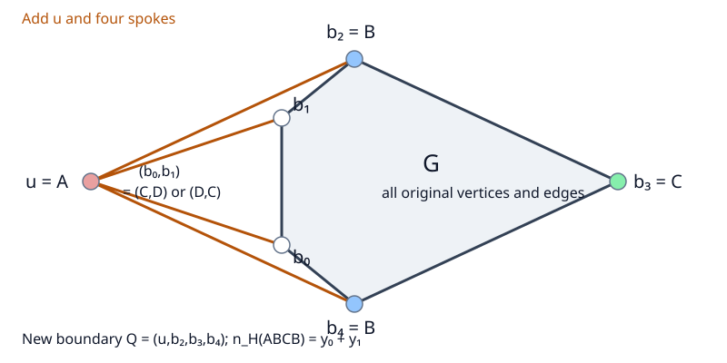

# 換邊界而不攻原圖：C5 → C4 與 K≤22

2026-10-14。回應「933／941 直接攻圖不順，換一個方向」的研究。
BASE `77fbd5da7ba273f0af7c75175dc08376d2282f46`；開始時工作樹已有其他未提交成果，
本包獨立建立，直接依賴另存於 [frozen](frozen/) 並由 [INPUTS](INPUTS.json) 記錄內容 hash。
未 commit／push，沒有改寫既有證書。

**本輪結果：補上完整 C5→C4 來源橋，接外部已報的完整計算結果，得到**

\[
\boxed{K_{\le22}=K_{\le5}=K132.}
\]

因此全域最小目錄外來源至少有 **23 個內點**。這同時涵蓋不先使用四色定理的
最小來源分類中的 **932、933、941**；不只涵蓋原來兩支。
這是新紙面化約加外部計算定理，不是本輪重新枚舉十六至二十二內點圖。
無界來源排除、`K∞=K≤5` 及本輪 Lean 形式化仍 **OPEN**。

## 1. 方向為何不同

不必繼續逐個分析原圖的五度點、外圈或 Kempe 阻擋。
保留原圖 G 的全部頂點與邊，只在外側增加一個點 u，連到 b0、b1、b2、b4。
新的外邊界是四邊形 Q=(u,b2,b3,b4)。

固定新框染色 Q=(A,B,C,B)。原點 b0、b1 都不能用 A、B，且彼此相鄰，
所以它們只能依序用 (C,D) 或 (D,C)。限制回原 C5，這兩種情況恰為 singleton-1
與 singleton-0。因而有全部完整 lifts 的不交聯集雙射，特別是

\[
\boxed{n_H(ABCB)=y_0(G)+y_1(G).}
\]

三個最小候選都拒絕這兩列，故 H 的這種對角染色不能延拓。
這使用同一原圖與同一色框；沒有把不同列的可行 witnesses 拼成同一染色。
四種新框染色的完整轉移、空 fibres 及計數係數見 [PROOF](PROOF.md)。

## 2. 為何確實能接文獻

沿用 [no4ct 正規形](frozen/audits/2026-10-13-c5-no4ct-dependency-6cafdfb/REPORT.md)
與 [度數修復](frozen/audits/2026-10-13-c5-no4ct-degrees-6cafdfb/REPORT.md)，
全域最小內點、再最大邊數的來源 G 有 induced C5 外框、全部內面三角形、
每個三角形皆界定面、內點度數至少五、框點度數至少四。

H 的內點是原 G 內點加上 b0、b1；後兩點各增加一條 u 邊，故全部內度仍至少五。
新增三角形恰是三個新的面，沒有非面三角形。新 C4 無弦，所以 H 不是 diamond。
這逐項符合 Dvořák–Lidický–Mohar 的 **4-candidate** 定義。

該文 arXiv v2 **§2、Table 1 及相鄰正文**報告：至多 28 個總頂點的全部
4-candidates 中，對角染色不能延拓者只有四點 diamond。
因此本構造必有

\[
|V(H)|=k+6>28,\qquad k\ge23.
\]

來源與精確信任界線見 [EXTERNAL](EXTERNAL.md)；原始論文為
[On a conjecture concerning 4-coloring of graphs with one crossing](https://arxiv.org/html/2504.08327v2#S2)。
我們直接使用其四邊界完整枚舉，不把未證 Conjecture 2 或 Theorem 10 的等價式當成無界定理。
完整 `K≤22` 的最小反例反證見 [PROOF](PROOF.md)。

## 3. 驗證與證據分層

- **一般紙面證明**：原面／度數合法性、任意大小的完整 fibre 雙射及最小反例接入。
- **本地固定域核對**：[主 checker](controls/check_transfer.py) 重建完整四態轉移，
  比較 132 份舊實圖的 528 份完整 fibres，保留空集合及具名負控制。
- **獨立審查**：[review](review/INDEPENDENT.md) 另行推導與核對，不 import 主 checker。
- **外部計算**：作者的完整 4-candidate 生成及染色檢查；本輪沒有重跑其十億級枚舉。
- **Lean**：本輪沒有新增定理，不把 Python／紙面證明稱為 Lean 驗證。

實際命令、結果與 hash 核對見 [VERIFICATION](VERIFICATION.md)。
固定 132 圖中沒有真正 932／933／941 來源；它們只是完整轉移的正控制。
三支排除依據是一般來源橋與外部完備範圍，並非 `not triggered`。

## 4. 留下的新窄問題

接下來可研究本構造產生的**具名 C4 子類**：外點 u 度數恰四，內側兩個鄰點
是原 b0、b1；其餘原圖與指定對角染色均保留。
要證的是這個子類任意大小都有 ABCB 延拓，而不是先解整份文獻的所有 one-crossing 猜想。
若能證成，便能排掉上述三支最小來源；本輪尚未完成這項無界引理。

另一個實際測試過的方向是把對偶染色改寫為匹配與偶環，再在同一原圖上交換匹配。
其精確公式、有限成功例及「閉圈數下降」的反控制保存在
[exploratory](exploratory/REPORT.md)。這些有限實驗沒有參與 `K≤22` 的證明。

本輪主線停止點與接續入口见 [Kempe 導覽](../../docs/c5_kempe_guide.md)。
