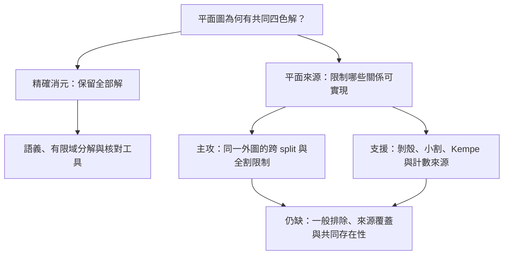

# 研究總覽：要完成的工作與可用成果

文件整理：2026-10-30；本頁按工作說明研究問題、可用成果與查閱路徑，不新增研究結論。
四色定理在數學界已證；本庫的 OPEN 指這條獨立證明路線尚缺的義務。
目前採納的結論、精確適用範圍與 OPEN 義務統一由[採納結論](research/CONCLUSIONS.md)維護，
完整推理、證明、證書與重播留在其連結的原報告。
目前主攻及第一個接續工作由 [4CT 研究契約](research/4ct_guide.md#精確消元主線的研究契約)維護。

## 按當輪工作進入

先選要完成的工作，再沿相應入口查前提、定義、證明及重播。完整研究報告保留供查證，
日常接手不要求逐篇閱讀，也不以文件數量判斷進度。

| 要完成的工作 | 從哪裡開始 | 完成或採用前須確認 |
| --- | --- | --- |
| 核對目前可採用的結論 | [採納結論](research/CONCLUSIONS.md) | 命題的圖類、量詞、前提、證據層及保留的 OPEN 義務。 |
| 接續四色證明 | [研究契約與第一個工作](research/4ct_guide.md#精確消元主線的研究契約) | 目標來源、量詞、共同見證及尚缺的證明義務。 |
| 執行求解或比較方法 | [四色工具導覽](tools/four_color_guide.md) | 輸入圖、完整關係、資源上限與共同回填；`limit` 仍是未判定。 |
| 驗證成果與實作 | [Lean 導覽](verification/lean_guide.md)及所用報告的驗證章節 | 紙證、Python 固定域、Lean 普通證明與 native 證書的各自範圍。 |
| 調用既有引理或接口 | [成果查找與使用](reference/results_guide.md) | 原圖與色框、完整 fibres、實際附件及報告的全部前提。 |
| 查舊結果或重接已停止方向 | [封存導覽](archive/archive_guide.md) | 當時停止點是否已有明列後續來源；仍有效的局部結果與尚未解決的父題分別判定。 |
| 接續交叉數研究 | [局部重畫導覽](research/crossing/zarankiewicz_guide.md) | 指定 drawing 假設、完整共同張量與一般不可避免性之間的界線。 |

## 核心問題

逐步消去頂點，把已處理部分對剩餘著色的限制完整留下，最後倒序回填。
這個流程已有精確語義；研究要補的是：**平面來源為何迫使這些限制至少有一份共同解？**

| 層次 | 能保證什麼 | 來源與界線 |
| --- | --- | --- |
| 保解 | 消元後的全部解，恰為原解在剩餘頂點上的投影；有共同解時可回填。 | [關係語義](tools/solver/four_color_mathematical_model.md)、[完備性](tools/solver/four_color_completeness.md)；不自行證明原解非空。 |
| 表示 | 一次消元等於所有大小至多 q 的原因子子族投影之合取，q 為消去點的候選色數。 | [有限域分解](tools/solver/four_color_bounded_projection.md)有紙證與 Lean；四因子不等於四變數，整次成本可能增加。 |
| 來源限制 | 同一平面嵌入、原附件與實際交換分量，能排除哪些抽象關係？ | [三步跨 split 來源引理](archive/reports/planar-sources/four_color_three_step_cross_split_exclusion.md)已有指定來源類排除；任意多圈外圖仍 OPEN。 |
| 存在性 | 來源限制能否涵蓋所有目標圖，並迫至少一份共同解？ | [研究驗收規格](research/4ct_guide.md#第一個接續工作)；局部排除、來源覆蓋與共同存在性須分別證明。 |

抽象上，令 Pᵢ 為第 i 步後的完整剩餘問題、Uᵢ 為剩餘原點，已有

\[
\operatorname{Sol}(P_i)=\pi_{U_i}\operatorname{Col}_4(G).
\]

這是等式；若兩側都空，它仍成立。獨立證明還要由平面來源推出非空。

## 共通語言：同一原圖、同一色框、同一見證

「完整接口關係」記錄有序接點的全部可行著色組合；每列能接回的全部內部選項稱為 fibre。
共同接合先對齊原接點與色框，再取完整關係；空 fibres 也保留，最後才選共同見證回寫。
各端點可用色、兩兩投影或各自非空，不能代替共同相容。
精確定義見[接口語義](tools/solver/four_color_mathematical_model.md#原問題是一份共同指派)。

Kempe 交換也在同一完整染色上進行；交換後各色對的連通分量須重新計算。
邊界 traces 忘掉的原圖連接，正是目前來源研究要找回的資訊；
[有限註記投影](archive/reports/planar-sources/four_color_three_step_annotation_projection.md)已證指定放鬆無關係增益，
[全割準則](archive/reports/planar-sources/four_color_three_step_remote_cut.md)則提供含全部遠端交換的必要附件條件，尚非一般存在性證明。

## 各方向如何銜接

下圖表示問題分工與查閱順序；箭頭不表示已證的數學蘊涵。

| 方向 | 在研究中承擔的問題 | 查閱入口 |
| --- | --- | --- |
| 4CT／平面消元 | 尋找來源不變量，補共同存在性；研究線標記見 HANDOFF。 | [主攻契約](research/4ct_guide.md#精確消元主線的研究契約)、[第一個工作](research/4ct_guide.md#第一個接續工作)；支援子題由同頁維護。 |
| 求解與 Lean | 提供完整關係消元、共同回填及可檢驗語義。 | [工具導覽](tools/four_color_guide.md)、[形式化導覽](verification/lean_guide.md)；Python 精化與平面拓撲證明須另補。 |
| C₅／932、933、941 | 舊分類提供接口與結構工具；E932 與 4CT 等價，933／941 是額外分類義務。 | [與原分類的關係](research/4ct_guide.md#與原c5分類主命題的關係)、[無 4CT 前提路線](tasks/c5_no4ct_handoff.md)；一般分類仍 OPEN。 |
| W7／J1、J2／奇環塊 | 保存具名來源排除與拒絕 fibres，按主攻需要調用。 | [Degree-5 導覽](archive/guides/c5_degree5_guide.md)、[Kempe 導覽](archive/guides/c5_kempe_guide.md)；保留原停止點，不另擴有限枚舉。 |
| 完全二分圖交叉數 | 獨立研究局部重畫、共同張量與旋轉相容性。 | [交叉數導覽](research/crossing/zarankiewicz_guide.md)；固定證書排除不封閉一般猜想，也不補 4CT 存在性。 |

E932 是「不存在合法 932 disk」。已證的是 **E932 ⇔ 4CT 的等價橋樑**；
本路線仍缺獨立的 E932 證明。PAIR-C0-D16 也只是目前具名阻擋族，排除它尚不代表覆蓋全部阻擋。

## 接續研究與查閱封存

日常先讀本頁理解全貌，再讀 [4CT 契約](research/4ct_guide.md#精確消元主線的研究契約)，
並以[採納結論](research/CONCLUSIONS.md)核對目前可採用的範圍，再展開本輪所需的來源報告。
執行工具、核對證據或調用引理時可直接由上表進入；
完整工作入口見 [HANDOFF](HANDOFF.md)，查特定檔案時使用 [STATUS 完整索引](STATUS.md)。

完整研究檔採短生命週期：供當輪推導、反控制與核對，核對完成後，同輪把採納結論、
範圍與剩餘義務整合到少數活躍文件，再將完整報告封存。未核實、有缺口或仍在推導的
研究檔可暫留，記明待核事項及接續入口；期限只提醒處理文件，不裁決命題完成。

封存保存逐輪推進、完整論證與驗證，仍可作為引理或證據來源。原報告承擔當輪證明與證書，
當前採納狀態集中由採納結論維護。移入封存不宣告結論失效，也不把未排程的方向改判完成。
舊「下一步／未解」及錯誤數值或構形身份由採納結論明列後續來源或有證據的更正，
保留當時紀錄供回溯。
一般來源覆蓋與共同存在性、合法封鎖 Kempe 分量，以及交叉數的一般不可避免性，
在採納結論中保留 OPEN 範圍；局部排除或完成一批有限核對不推升父題。

| 文件層 | 維護責任 |
| --- | --- |
| 本總覽 | 跨線概念、問題分工與閱讀路徑；不逐輪累加數字、狀態卡或下一步。 |
| 採納結論 | 唯一目前採納狀態：結論、精確適用範圍、證據層、OPEN 義務與後續涵蓋關係；連向完整來源。 |
| 4CT 契約／各線導覽 | 4CT 契約維護主攻、驗收與接續工作；各線導覽提供問題說明與來源查找。 |
| 完整研究檔與證據 | 當輪的完整假設、推理、證明、全部 fibres、證書與重播；核對整合後封存，不逐份維護目前狀態。 |
| 成果查找／封存導覽 | 依用途定位來源，說明後續涵蓋及歷史查閱方式；不另作數學裁決。 |
| STATUS／封存目錄／歷史 | 功能入口／完整直接索引／當輪研究及發布紀錄；按需查找，不另維護當前採納結論。 |

新增結果核對後更新採納結論；接續義務影響主攻時同步更新 4CT 契約。
需要保留獨立推導或證據時建立完整研究檔，整合後封存；既有報告按其採納範圍引用。
紙證、Python 固定域核對、Lean 普通證明與 native 證書分別標示；`limit` 仍是未判定。
完整維護與驗證規則見 [DOCUMENTATION](DOCUMENTATION.md)。
